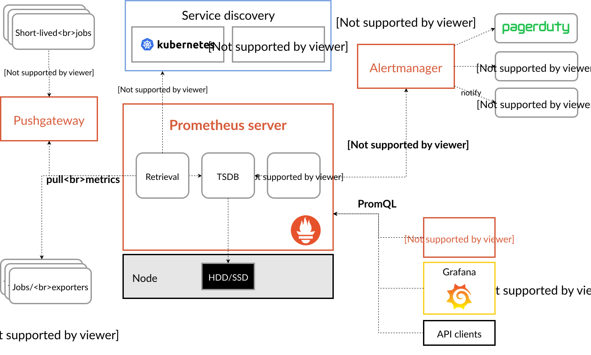

# System Architecture

#### Components 

The Prometheus ecosystem consists of multiple components, many of which are optional:

* the main [Prometheus server ](https://github.com/prometheus/prometheus) which scrapes and stores time series data
* [client libraries](https://prometheus.io/docs/instrumenting/clientlibs/) for instrumenting application code
* a [push gateway ](https://github.com/prometheus/pushgateway) for supporting short-lived jobs
* special-purpose [exporters](https://prometheus.io/docs/instrumenting/exporters/) for services like HAProxy, StatsD, Graphite, etc.
* an [alertmanager ](https://github.com/prometheus/alertmanager) to handle alerts
* various support tools

Most Prometheus components are written in [Go ](https://go.dev/), making them easy to build and deploy as static binaries.

#### Architecture 

This diagram illustrates the architecture of Prometheus and some of its ecosystem components:

<figure><figcaption></figcaption></figure>

### Grafana as an API consumer:

* [https://grafana.com/docs/grafana/latest/datasources/prometheus/](https://grafana.com/docs/grafana/latest/datasources/prometheus/)

## Primary Features

Prometheus offers a combination of important features over other monitoring solutions:

* A dimensional data model that allows faceted tracking of metrics
* A powerful query language to provide flexible answers
* Integration of time series processing and alerting
* Integration with service discovery to determine monitoring targets
* Operational simplicity
* A highly efficient implementation.

Although many of these features are becoming more common in monitoring systems these days, Prometheus was the first open source solution to combine them all.

We will discuss each of these points in more detail on the following pages.
