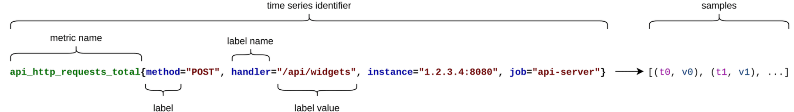

# Data Model

Prometheus stores time series. A time series has an identifier and a set of samples that belong to it:

<figure><figcaption></figcaption></figure>

### Labels

Every series is identified by a metric name and a set of key-value pairs called `labels`.

*   the **metric name** identifies the overall aspect of a system that is being  measured.

    * `api_http_requests_total`: the total number of API HTTP requests processed so far:

    
<figure><figcaption></figcaption></figure>

* **Labels** differentiate subdimensions or facets of the metric. They work similar to labels in Kubernetes and Docker:

<figure><figcaption></figcaption></figure>

* **Samples** form the bulk data of a time series:
  * `timestamps` - 64-bit integers in milliscond precision;  Input timestamps may be provided either in [RFC3339](https://datatracker.ietf.org/doc/html/rfc3339) format or as a [Unix timestamp in seconds](https://datatracker.ietf.org/doc/html/rfc3339#appendix-A), with optional decimal places for sub-second precision. Output timestamps are always represented as Unix timestamps in seconds.
  * `sample` values are 64-bit floating point numbers.

<figure><figcaption></figcaption></figure>

